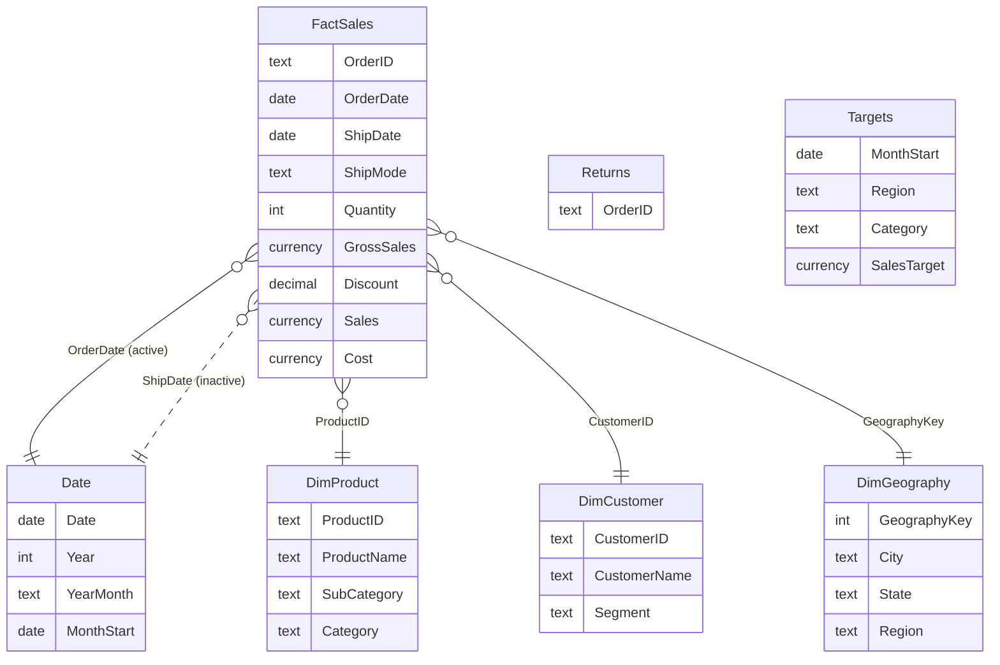

# Retail Sales Performance · Power BI & DAX

A Power BI sales analytics model for a US office-supplies retailer (2023–2025): **11k order lines,
a star schema, 60 DAX measures and a calculation group**. It covers time intelligence, virtual relationships, what-if
analysis, dynamic Top N, Pareto and new-vs-returning customers.

Every DAX measure ships with a **test query** and an **independent answer key**
([`docs/expected_results.md`](docs/expected_results.md), computed in Python), so you can check
that each number in the report is correct, not just that the DAX runs.

> **Data**: synthetic, generated by [`scripts/generate_data.py`](scripts/generate_data.py) (seeded, so it is reproducible).
> It is modelled on a typical superstore: seasonality, growth, discount-driven losses, returns, sales
> targets, plus deliberate data-quality issues for Power Query to fix.

---

## Business questions

1. How are sales and profit trending, and are we hitting target?
2. Where are we losing margin: which regions, categories and discount levels?
3. What would capping discounts be worth?
4. Is growth coming from new customers or from existing ones?
5. Which products drive the business?

## Key findings

| # | Finding | Evidence (measure) |
|---|---|---|
| 1 | **Discounts above 20% destroy profit.** Undiscounted sales earn a 32.9% margin; the 21–30% band earns 0.4%, and above 30% loses 25.8%. Deep discounts are only 3.6% of sales but are net loss-making. | `[Profit Margin %]` by `FactSales[Discount Band]` |
| 2 | **Capping discounts at 20% would add up to ~$31k profit (+3.2%)**, assuming the same orders still happen. | `[Profit Uplift from Cap]` with *Discount Cap* = 20% |
| 3 | **Central is the margin problem.** It discounts the most (7.0% vs 4–5% elsewhere), has the lowest margin in *every* category, and was the only region below target in 2025 (90%). | Category × Region matrix, `[% of Target]` |
| 4 | **Tables is the weakest sub-category**: the 3rd largest by sales, but only a 13.0% margin. | `[Profit Margin %]` by `DimProduct[SubCategory]` |
| 5 | **Growth is coming from existing customers.** Sales rose 22.5% in 2025 (after a flat 2024, +1.2%), but new customers fell from 458 → 310 → 118 a year. 85% of 2025 customers were returning, so acquisition is a risk to future growth. | `[Sales YoY %]`, `[New Customers]`, `[Returning Customers]` |
| 6 | **West is the largest region, but has the highest return rate** (11.7% vs 6–7.5%). Worth checking with operations. | `[Return Rate %]` by Region |

**Recommendation**: require approval for discounts above 20% (starting with Central and Furniture),
review Tables pricing, investigate West returns, and fund customer acquisition before the returning
base plateaus.

---

## Data model

A star schema: one fact table, four dimensions with single-direction one-to-many relationships,
two tables connected only *virtually* (TREATAS), and two disconnected parameter tables.



| Table | Rows | Role |
|---|---:|---|
| `FactSales` | 10,991 (after removing 71 duplicates) | Order lines, grain = order × product |
| `DimProduct` / `DimCustomer` / `DimGeography` | 123 / 900 / 21 | Dimensions |
| `'Date'` | 1,096 | DAX calendar, marked as date table |
| `Returns` | 452 | **No relationship**: joined in DAX with `TREATAS` |
| `Targets` | 288 | Month × Region × Category grain. **No relationship**: `TREATAS` |
| `'Top N'`, `'Discount Cap'` | 5 / 11 | Disconnected parameter tables for slicers |
| `_Measures` | n/a | Home table for all measures |

**Why not just relate `Targets`?** Its grain (month/region/category) is coarser than the
dimensions (day/city/product). A physical relationship would be many-to-many. Mapping the filters
with `TREATAS` keeps the model a clean star.

---

## DAX skills demonstrated

| Concept | Measures | File |
|---|---|---|
| Base measures & safe division | `Total Sales`, `Profit Margin %`, `Discount %` (value-weighted) | [`01_base_measures.dax`](dax/01_base_measures.dax) |
| Virtual relationship (`TREATAS`) | `Returned Orders`, `Return Rate %`, `Sales Target` | 01, 05 |
| Time intelligence | `Sales PY`, `YoY %`, `YTD/QTD/MTD`, `PYTD`, `MoM %`, `Rolling 3M`, `Running Total` | [`02_time_intelligence.dax`](dax/02_time_intelligence.dax) |
| Inactive relationship (`USERELATIONSHIP`) | `Sales by Ship Date` | 02 |
| Iterators & context transition | `Loss-making Orders`, `Products at a Loss`, `Simulated Profit` (`SUMX`) | [`03_profitability.dax`](dax/03_profitability.dax) |
| What-if parameter | `Discount Cap Value`, `Simulated Profit`, `Profit Uplift from Cap` | 03 |
| `ALLSELECTED` benchmarking | `Margin vs Average (pts)`, `% of Total Sales` | 03, 04 |
| Ranking (`RANKX`, `ISINSCOPE`) | `Product Sales Rank` | [`04_ranking_and_customers.dax`](dax/04_ranking_and_customers.dax) |
| Dynamic Top N (`TOPN` + `KEEPFILTERS`) | `Top N Sales`, `Top N Share %` | 04 |
| Virtual tables (`ADDCOLUMNS`, `FILTER`) | `Cumulative Sales %`, `Products for 80% of Sales` (Pareto) | 04 |
| Customer analytics | `New Customers`, `Returning Customers`, `Repeat Customer Rate %` | 04 |
| Conditional formatting & dynamic text | `Target Status Color`, `YoY Color`, `Title Sales Trend`, `Headline Insight` | [`05_targets_and_report_ui.dax`](dax/05_targets_and_report_ui.dax) |
| Calculation group (`SELECTEDMEASURE`) | Current / PY / YoY / YoY % / YTD / Rolling 3M for *any* measure | [`06_calculation_group.dax`](dax/06_calculation_group.dax) |
| Calculated tables & columns | `'Date'`, `'Top N'`, `'Discount Cap'`, `Discount Band`, `Days to Ship` | [`00_calculated_tables_and_columns.dax`](dax/00_calculated_tables_and_columns.dax) |

### Three measures worth explaining in an interview

**New customers**: "new" depends on the period being viewed, so it can't be a column:

```dax
New Customers =
VAR _periodStart = MIN ( 'Date'[Date] )
VAR _periodEnd   = MAX ( 'Date'[Date] )
VAR _customersWithFirstOrder =
    ADDCOLUMNS (
        VALUES ( FactSales[CustomerID] ),                      -- customers active in the period
        "@FirstOrder", CALCULATE ( MIN ( FactSales[OrderDate] ), REMOVEFILTERS ( 'Date' ) )
    )                                                          -- their first order EVER
RETURN
    COUNTROWS ( FILTER ( _customersWithFirstOrder,
        [@FirstOrder] >= _periodStart && [@FirstOrder] <= _periodEnd ) )
```
`CALCULATE` inside `ADDCOLUMNS` causes **context transition**: each customer row becomes a filter,
and `REMOVEFILTERS('Date')` widens the time window to all history.

**Sales target via a virtual relationship**:

```dax
Sales Target =
CALCULATE (
    SUM ( Targets[SalesTarget] ),
    TREATAS ( VALUES ( DimGeography[Region] ), Targets[Region] ),
    TREATAS ( VALUES ( DimProduct[Category] ), Targets[Category] ),
    TREATAS ( VALUES ( 'Date'[Month Start] ), Targets[MonthStart] )
)
```

**What-if discount cap**: the cap must be applied per line *before* summing, so it needs an iterator:

```dax
Simulated Profit =
VAR _cap = [Discount Cap Value]
RETURN
    SUMX ( FactSales,
        FactSales[GrossSales] * ( 1 - MIN ( FactSales[Discount], _cap ) ) - FactSales[Cost] )
```

---

## Build it in Power BI Desktop (about 45 minutes)

1. **Load data**: *Home → Transform data*. Create the `DataFolder` parameter and the
   `fnGetCsv` function, then one Blank Query per table, pasting the code from
   [`powerquery/`](powerquery). The parameter points at the CSVs on GitHub by default, so there's
   nothing to download (or point it at a local copy of `data/`). *Close & Apply*.
2. **Model**: create the tables and columns in [`dax/00_calculated_tables_and_columns.dax`](dax/00_calculated_tables_and_columns.dax)
   (*Modeling → New table / New column*). Mark `'Date'` as the date table. In *Model view*, create
   the relationships shown in the diagram (`ShipDate` inactive). Do **not** relate `Returns` or `Targets`.
3. **Measures**: open *DAX query view*, paste [`01_base_measures.dax`](dax/01_base_measures.dax),
   press **Run**, compare the output with [`docs/expected_results.md`](docs/expected_results.md), then click
   **Update model with changes**. Repeat for files 02 → 05, in order (later files use earlier measures).
   Afterwards, set display folders and format strings (currency `$#,0`, percentages `0.0%`).
4. **Optional**: add the calculation group from file 06.
5. **Report**: build the five pages described in [`docs/dashboard-design.md`](docs/dashboard-design.md).
6. **Publish**: save as `Retail_Sales_DAX.pbix` (or *Save as → Power BI Project* for a text,
   git-friendly `.pbip`). Add screenshots to `docs/img/` and link them below.

## Check your numbers

```bash
pip install -r requirements.txt
```

```bash
python scripts/validate_measures.py
```

This re-implements the cleaning and every key measure in pandas and rewrites
`docs/expected_results.md`. If a Power BI visual disagrees with it, a relationship or the filter
context is wrong. That's the point of having an independent check.

To regenerate the dataset (it is identical every run because the seed is fixed):

```bash
python scripts/generate_data.py
```

## Project structure

```
retail-sales-dax/
├── data/                      CSV source files (fact, dimensions, returns, targets)
├── powerquery/                M code: parameter, CSV function, one query per table
├── dax/
│   ├── 00_calculated_tables_and_columns.dax   Date table, parameter tables, columns
│   ├── 01_base_measures.dax                   ┐
│   ├── 02_time_intelligence.dax               │ each file = DEFINE MEASUREs
│   ├── 03_profitability.dax                   │ + EVALUATE test queries
│   ├── 04_ranking_and_customers.dax           │ (run in DAX query view)
│   ├── 05_targets_and_report_ui.dax           ┘
│   └── 06_calculation_group.dax               calculation group items
├── docs/
│   ├── expected_results.md    answer key for every test query
│   └── dashboard-design.md    page-by-page report spec
└── scripts/
    ├── generate_data.py       reproducible synthetic dataset
    └── validate_measures.py   independent pandas check of the DAX
```

## Screenshots

*Add after building the report:* `docs/img/overview.png`, `docs/img/profitability.png`, …
